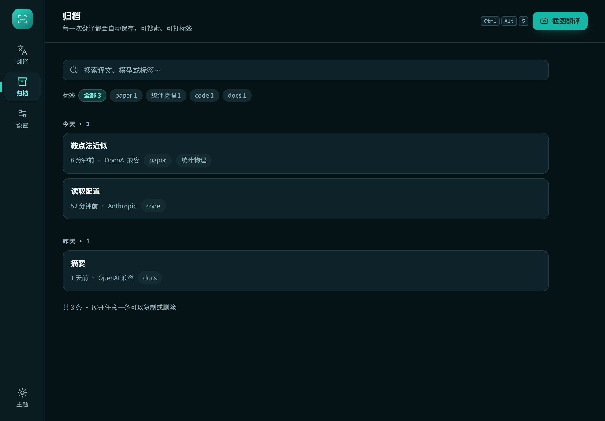
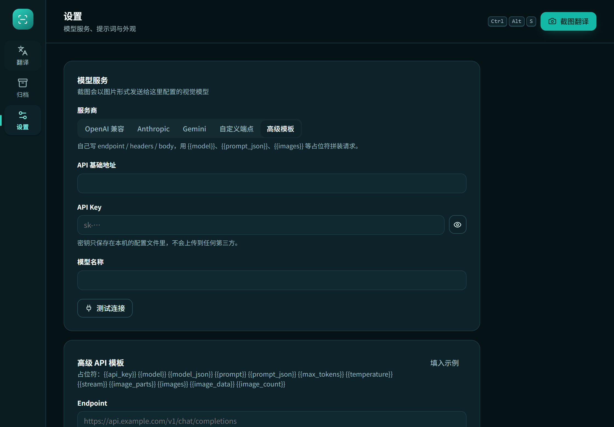
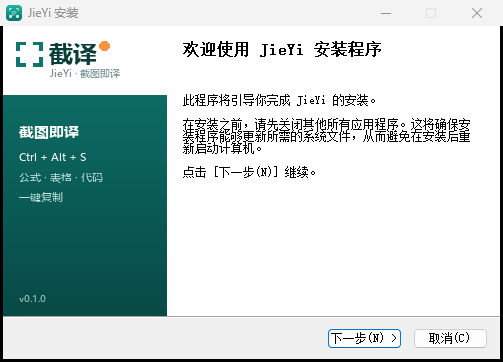

# 截译 · JieYi

截图即得译文的桌面工具：框选任意屏幕区域，交给视觉大模型翻译，公式/表格原样排版，结果自动归档、可打标签、一键复制或导出 Markdown。

Rust + Tauri 2 外壳，React 19 + TypeScript 前端。是 `AI-Screenshot-Translator`（Qt6/C++）的 clean-room 重写。

```
Ctrl + Alt + S  →  拖框（可框多块）→  Enter  →  译文（KaTeX 公式 / 表格）→  复制 / 导出
```

[](https://github.com/Fakeboxs/AI_jieyi/releases)
[](LICENSE)
[](#系统要求)
[](https://tauri.app)
[](https://react.dev)


## 下载

到 [Releases](https://github.com/Fakeboxs/AI_jieyi/releases/latest) 下载：

| 文件 | 大小 | 适合 |
|---|---|---|
| `JieYi_0.2.0_x64-setup.exe` | 3.9 MB | 推荐。当前用户安装（无需管理员），中文向导，缺 WebView2 自动下载 |
| `JieYi-0.2.0-portable-win64.zip` | 4.68 MB | 便携版，解压即用 |

首次运行若被 SmartScreen 拦下：**更多信息 → 仍要运行**（安装包未做代码签名）。

## 快捷键

| 按键 | 作用 |
|---|---|
| `Ctrl+Alt+S` | 截图（冻结鼠标所在屏幕 / 设置里指定的屏幕）并框选 |
| `Ctrl+Alt+D` | 重复上次区域，不弹选区直接翻译 |
| `拖动` / `Enter` / `Backspace` / `Esc` | 框一块 / 提交全部 / 撤销上一块 / 取消 |
| `Ctrl+Shift+C` | 复制当前译文 |
| `Ctrl+1` `Ctrl+2` `Ctrl+3` | 翻译 / 归档 / 设置 |

## 现在能做什么

**截图与请求**

- **全局热键**：`Ctrl+Alt+S` 在任意应用里触发，整屏冻结后框选
- **多块合并翻译**：一次可以连续拖出多个框，`Enter` 把 N 块一起发给模型（一次请求、一份译文），`Backspace` 撤销上一块
- **上次选区记忆**：再次截图时用虚线预选上次的框（可直接 `Enter` 复用，也可以随手拖新框顶掉它）；`Ctrl+Alt+D` 则完全跳过选区，直接按上次位置翻译
- **多显示器**：设置里可选「跟随鼠标所在屏幕」或固定某一块屏幕
- **流式 / 直出可选**：SSE 流式（默认，首字即显示、边生成边排版、末尾打字光标）或一次性直出；**流式中途可以随时「停止」**，已生成的部分会保留并照常入库
- **多服务商**：OpenAI 兼容（SiliconFlow / DashScope 兼容模式 / 本地 vLLM、Xinference）、Anthropic `/v1/messages`、Gemini `generateContent`、自定义端点
- **高级 API 模板**：自己写 endpoint / headers / request body，用 `{{model}}`、`{{prompt_json}}`、`{{image_parts}}`、`{{stream}}`、`{{api_key}}` 等占位符拼装，响应字段用 JSON Pointer 指定——任何非标准协议都能接

**结果与归档**

- **排版还原**：Markdown（marked + DOMPurify 白名单）+ KaTeX（`$…$`、`$$…$$`、`\(…\)`、`\[…\]`、`equation/align`）+ 代码高亮 + 表格；流式时自动隐藏写了一半的公式尾巴
- **一键复制**：主按钮复制 Markdown 译文，另可复制纯文本；按钮变绿 + toast 提示
- **标签**：结果页底部直接加/删标签（回车确认），归档页按标签过滤
- **导出 .md**：一键另存为 Markdown（自动带上标签与来源脚注）
- **归档**：SQLite 自动保存每次翻译（含截图 PNG）、按天分组、全文搜索、重新翻译、删除

**外壳**

- 单窗口三标签（翻译 / 归档 / 设置），只有一个 WebView2 宿主
- 托盘：左键截图，右键菜单（截图翻译 / 重复上次区域 / 显示主窗口 / 退出）
- 无遥测、无联网检查更新

## 界面

| 流式生成中（可随时停止） | 归档 |
|---|---|
|  |  |

| 高级 API 模板 | 安装向导 |
|---|---|
|  |  |

## 系统要求

- Windows 10 1809+ / Windows 11，x64
- Microsoft Edge WebView2 Runtime（安装包会自动补装；便携版需系统已有）
- 能访问你所配置的模型服务

## 跑起来

```bash
npm install
npm run tauri dev          # 开发（vite + 热更新）
npm run tauri build        # 出 NSIS 安装包（target/release/bundle/nsis）
```

前置：Rust stable、Node 20+、系统 WebView2（Win11 自带）。

### 本地联调（不花钱、不需要真 key）

```bash
python scripts/mock_server.py 8899                    # 假 OpenAI 兼容服务
JIEYI_MOCK_CHUNK_DELAY=0.25 python scripts/mock_server.py 8899   # 放慢分片，方便试「停止」
```

把设置里的 API 基础地址改成 `http://127.0.0.1:8899/v1`，Key 随便填，模型填 `mock-vl`，然后 `Ctrl+Alt+S` 框一块屏幕即可跑通全链路。

## 结构

```
src/                      React 前端
  App.tsx                 三标签外壳、事件订阅、复制/导出/标签
  overlay.tsx             全屏框选层（多块框选、预选、尺寸提示、快捷键）
  components/Reader.tsx   流式卡片、结果卡片、标签编辑、Markdown 渲染
  components/Archive.tsx  搜索、标签过滤、按天分组
  components/Settings.tsx 模型服务 / 高级模板 / 翻译偏好 / 截图 / 外观
  lib/bridge.ts           IPC 封装（含浏览器预览 mock）
  lib/markdown.ts         LaTeX 保护 → marked → 消毒 → KaTeX
  styles/app.css          设计令牌（浅/深）+ 组件样式
src-tauri/src/
  lib.rs                  托盘、双全局热键、窗口编排、命令注册、取消标志
  capture.rs              xcap 抓屏、显示器枚举、多区域裁剪、PNG/Base64
  providers.rs            四种协议 + 高级模板渲染、SSE 解析、可中断流
  store.rs                SQLite（与旧版 history.db 表结构兼容，多图一行）
  config.rs               config.json（含 advanced / capture_screen / remember_region）
design-system/jieyi/MASTER.md   ui-ux-pro-max 生成的设计系统（本项目的令牌来源）
scripts/                  图标生成 / mock 服务 / 打包脚本
```

数据目录：`%APPDATA%\app.jieyi.desktop\`（`config.json`、`jieyi.db`、`images\*.png`、`last_region.json`）。
旧版 `history.db` 可直接放进来：表结构一致，新增的 `provider / model / elapsed_ms` 列会自动 `ALTER TABLE` 补上。

### 高级 API 模板

| 占位符 | 含义 |
|---|---|
| `{{api_key}}` `{{model}}` `{{model_json}}` | Key、模型名（原样 / 已 JSON 转义） |
| `{{prompt}}` `{{prompt_json}}` | 系统提示词（原样 / 已 JSON 转义） |
| `{{max_tokens}}` `{{temperature}}` `{{stream}}` | 数值与布尔值，直接当 JSON 字面量用 |
| `{{image_parts}}` | 展开成多个 OpenAI 风格 `image_url` part（**不含外层 `[]`**） |
| `{{images}}` | 图片 data URL 的 JSON 数组 |
| `{{image_data}}` `{{image_count}}` | 第一张图的裸 base64、图片数量 |

示例（OpenAI 形状，可直接点「填入示例」生成）：

```json
{
  "model": {{model_json}},
  "max_tokens": {{max_tokens}},
  "messages": [
    { "role": "user", "content": [
      {{image_parts}},
      { "type": "text", "text": {{prompt_json}} }
    ] }
  ]
}
```

`stream` 由应用决定：模板里没写 `stream` 字段时，流式模式会自动补上 `"stream": true`。
响应字段填 JSON Pointer（如 `/choices/0/message/content`），留空则自动尝试 OpenAI / Anthropic / Gemini 的常见结构。

## 已验证（真机跑过，不是"应该能跑"）

| 项 | 结果 |
|---|---|
| 全局热键 | `Ctrl+Alt+S` 在桌面任意位置触发，覆盖层出现；`Ctrl+Alt+D` 跳过选区直接翻译 |
| 抓屏 + 框选 | 冻结画面、拖动有尺寸提示、`Esc` 取消 |
| **多块合并** | 连拖两块后 `Enter`：mock 日志 `images=2 bytes=89536 stream=True`（**一次请求**），库里 `image_files_json` 两条、磁盘两张 PNG，译文一份 |
| **停止生成** | 流式中途点「停止」：2.0s 落库 95 字符（完整版 367 字符），服务端记录连接被客户端中止（`WinError 10053`），toast「已停止生成，保留了已生成的部分」，按钮恢复为「复制译文」 |
| **高级模板** | `provider=advanced`、`model=adv-mock-vl`，自定义 header + 占位符 + JSON Pointer 全部生效，367 字符流式返回；模板写错时 toast 精确到行列（`expected ',' or '}' at line 6 column 55`） |
| **标签编辑** | 结果页加 `physics` → 变成 chip，`tags_json` = `["physics"]`，归档页按标签过滤正常 |
| **导出 .md** | 系统保存对话框 → 落盘 289 字节，含译文、`标签：physics` 与「由截译导出 · 时间 · 模型」脚注 |
| **上次选区** | `last_region.json` = `{"x":420,"y":330,"w":620,"h":290}`；再次截图虚线预选，随手拖新框会顶掉预选 |
| 响应解析 + 落库 | `entries` 新增行，主窗口自动切到结果页 |
| 渲染 | 标题/段落/行内公式/独立公式/表格/引用块全部正确 |
| 一键复制 | 按钮变「✓ 已复制」+ toast；剪贴板内容 = 367 字符 Markdown |
| 错误路径 | 未填 Key → toast「还没有填写 API Key（设置 → 模型服务）」，不崩 |
| release 构建 | `target/release/jieyi.exe` 8.76MB；NSIS 安装包 `JieYi_0.2.0_x64-setup.exe` 3.93MB |
| 安装/卸载 | 静默装 → `%LOCALAPPDATA%\截译`，注册表/桌面/开始菜单齐全；`uninstall.exe /S` 全部清除，用户数据保留 |
| SSE 流式 | `stream=True`；首字 0.3s 内出现、带「生成中」+ 光标；完成后徽标消失 |
| 直出模式 | `stream=False`；骨架屏 + 禁用按钮，整段到达后一次渲染 |

> 未在本机验证：真正的双屏/三屏硬件（测试环境只有一块屏）——「跟随鼠标」与「指定屏幕」两条分支都按显示器坐标 + 缩放比实现，但没在物理双屏上跑过。

## 体积与内存（实测）

| | 旧版（Qt6/C++） | 新版（Tauri 2） |
|---|---|---|
| 安装体积 | 62MB 目录（Qt DLL 24MB + opengl32sw 20.6MB + D3Dcompiler 4.2MB + 插件 3.5MB） | **exe 8.76MB / 安装包 3.93MB** |
| 主进程 | 33.7MB WS / 6.8MB Private（未开窗） | 32.7MB WS / 5.6MB Private（主窗口已开） |
| WebView2 宿主 | 每个窗口一套（结果窗、归档窗各一） | 一套（单窗口三标签） |
| 依赖 | Qt6 运行时 + 5 个 Qt 插件目录 | 系统 WebView2，无额外运行时 |

> 内存的真相没变：占用大头仍是 WebView2/Chromium（本机整套 7 个进程，Private 合计 221.5MB）。
> 新版赢在"只有一套宿主"、磁盘 62MB → 8.5MB、以及去掉 Qt 依赖后冷启动更快。换语言几乎不降内存，能降的是磁盘和进程数。

## 与旧版的差异（取舍）

| 旧版 | 新版 |
|---|---|
| 只能等整段返回 | SSE 流式 / 直出 可选，且可中途停止 |
| 一次框多块 | 一次框多块（拖动累积，Enter 提交） |
| Qt Widgets 设置/归档 + WebView2 结果窗口（多宿主） | 单窗口三标签，单 WebView2 宿主 |
| 复制=按 `R` 切原始视图顺带复制 | 常驻复制按钮 + 纯文本复制 + 导出 .md |
| 归档只读列表、删除靠 `dd` | 搜索、标签 chip（可编辑）、展开即复制/删除 |
| 62MB 目录（Qt + opengl32sw + D3Dcompiler） | 单个 exe + 系统 WebView2 |
| 高级 API 模板 `{{占位符}}`、自定义 headers | 已移植：endpoint/headers/body/response_path + 12 个占位符 |
| 多显示器、上次选区记忆 | 已移植：指定屏幕 + 虚线预选 + `Ctrl+Alt+D` 直达 |
| Umami 匿名统计默认开启 | 无任何遥测 |

## 还没做（下一步候选）

1. 安装包签名 + 自动更新（Tauri updater）
2. macOS / Linux 构建（`capture.rs` 需换平台实现）
3. 译文导出 PDF、整个归档批量导出
4. 目标语言可选（不止中文）

## 分发

```bash
python scripts/gen_icons.py            # 应用图标（一次性）
python scripts/gen_installer_art.py    # 安装向导侧边栏/页眉（一次性）
python scripts/make_release.py         # 汇总 dist-release：安装包 + 便携包 + SHA256SUMS
```

`dist-release/` 产出：

| 文件 | 说明 |
|---|---|
| `JieYi_0.2.0_x64-setup.exe` | NSIS 安装包，**当前用户安装**（`%LOCALAPPDATA%\截译`），中文向导，缺 WebView2 自动下载 |
| `JieYi-0.2.0-portable-win64.zip` | 便携版：`jieyi.exe` + 使用说明，解压即用 |
| `发布说明.md` / `SHA256SUMS.txt` | 面向用户的说明与校验和 |

**未做代码签名**，分发时提醒用户：SmartScreen 提示 → 更多信息 → 仍要运行。要彻底消除需要签名证书：

```powershell
signtool sign /fd SHA256 /tr http://timestamp.digicert.com /td SHA256 /a dist-release\JieYi_0.2.0_x64-setup.exe
```

> 改了 `productName`（当前为「截译」）会同时改变安装目录、快捷方式与「应用」里的显示名；`identifier` 保持不变，所以升级不会丢数据。

## 许可与来源

- 代码以 [MIT](LICENSE) 发布；第三方依赖与来源说明见 [NOTICE.md](NOTICE.md)。
- 本项目按 clean-room 思路重写：只借鉴「截图→视觉模型→Markdown」的产品思路与用户可见交互，未复制上游 C++ 代码、模板与图标资源，因此不受上游 GPL-3.0 传染。若后续要复用上游任何代码/资源，本仓库必须改为 GPL-3.0 并保留版权声明。
- 上游：`https://github.com/Diraw/AI-Screenshot-Translator`（GPL-3.0）——本仓库不包含其任何代码或资源。
