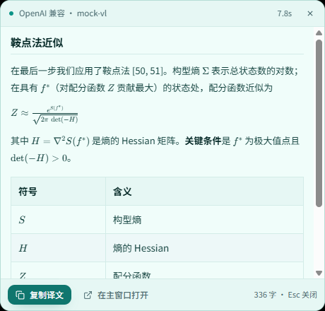
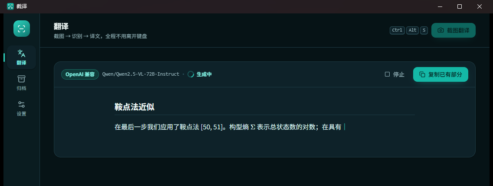

1|# 截译 · JieYi
2|
3|截图即得译文的桌面工具：框选任意屏幕区域，交给视觉大模型翻译，公式/表格原样排版，结果自动归档、可打标签、一键复制或导出 Markdown。
4|
5|Rust + Tauri 2 外壳，React 19 + TypeScript 前端。是 `AI-Screenshot-Translator`（Qt6/C++）的 clean-room 重写。
6|
7|```
8|Ctrl + Alt + S  →  拖框（可框多块）→  Enter  →  译文（KaTeX 公式 / 表格）→  复制 / 导出
9|```
10|
11|[](https://github.com/Fakeboxs/AI_jieyi/releases)
12|[](LICENSE)
13|[](#系统要求)
14|[](https://tauri.app)
15|[](https://react.dev)
16|
17|
18|
19|## 下载
20|
21|到 [Releases](https://github.com/Fakeboxs/AI_jieyi/releases/latest) 下载：
22|
23|| 文件 | 大小 | 适合 |
24||---|---|---|
| `JieYi_0.6.0_x64-setup.exe` | 4.0 MB | 推荐（联网版）。只装程序，离线模型按需下载 |
| `JieYi-0.6.0-portable-win64.zip` | 4.7 MB | 便携版，解压即用 |
| `JieYi-0.6.0-offline-win64.zip.001/.002` | 3.6 GB | **带资源包版**：解压即可断网翻译，不用再下载模型 |
27|
28|首次运行若被 SmartScreen 拦下：**更多信息 → 仍要运行**（安装包未做代码签名）。
29|
30|## 快捷键
31|
32|| 快捷键 | 作用 |
33||---|---|
34|| `Ctrl+Alt+S` | 截图（冻结鼠标所在屏幕 / 设置里指定的屏幕）并框选 |
35|| `Ctrl+Alt+D` | 重复上次区域，不弹选区直接翻译 |
36|| `拖动` / `Enter` / `Backspace` / `Esc` | 框一块 / 提交全部 / 撤销上一块 / 取消 |
37|| `Ctrl+Shift+C` | 复制当前译文 |
38|| `Ctrl+1` `Ctrl+2` `Ctrl+3` `Ctrl+4` | 翻译 / 文本 / 归档 / 设置 |
39|| `Ctrl+Enter` | 文本标签页里直接翻译输入框内容 |
40|
41|前两个是**全局热键，可以在设置 → 快捷键与数据里改绑**（点一下输入框，按下想要的组合键）。保存时会真的去系统注册一次：组合被占用会当场报错并保留原来的绑定，两个功能填成同一个也会被拦下。
42|
43|## 现在能做什么
44|
45|**截图与请求**
46|
47|- **全局热键**：`Ctrl+Alt+S` 在任意应用里触发，整屏冻结后框选
48|- **多块合并翻译**：一次可以连续拖出多个框，`Enter` 把 N 块一起发给模型（一次请求、一份译文），`Backspace` 撤销上一块
49|- **上次选区记忆**：再次截图时用虚线预选上次的框（可直接 `Enter` 复用，也可以随手拖新框顶掉它）；`Ctrl+Alt+D` 则完全跳过选区，直接按上次位置翻译
50|- **多显示器**：设置里可选「跟随鼠标所在屏幕」或固定某一块屏幕
51|- **结果用独立小窗**：热键翻译的译文出现在选区旁边的窄边置顶浮窗（460px、无标题栏、可拖动缩放），不打断你正在做的事；可在设置里切回主窗口
52|- **默认关闭思考模式**：DeepSeek 等模型默认开启 thinking，会先"想"几秒甚至吃掉整个 token 预算；应用默认发 `thinking: {"type":"disabled"}`，实测首字从"等十秒/不出字"降到 **1s 左右**（设置里可改回服务商默认或开启）
53|- **流式 / 直出可选**：SSE 流式（默认，首字即显示、边生成边排版、末尾打字光标）或一次性直出；**流式中途可以随时「停止」**，已生成的部分会保留并照常入库
54|- **多服务商**：OpenAI 兼容（SiliconFlow / DashScope 兼容模式 / 本地 vLLM、Xinference）、Anthropic `/v1/messages`、Gemini `generateContent`、自定义端点
55|- **高级 API 模板**：自己写 endpoint / headers / request body，用 `{{model}}`、`{{prompt_json}}`、`{{image_parts}}`、`{{stream}}`、`{{api_key}}` 等占位符拼装，响应字段用 JSON Pointer 指定——任何非标准协议都能接
56|
57|**文本翻译**
58|
59|- **粘贴即翻**：主界面新增「文本」标签页，把外文粘进输入框（`Ctrl+Enter` 或点「翻译」）就直接走同一条流式管线，不需要截图
60|- 支持「粘贴」按钮（读剪贴板）与「清空」，译文照常渲染 Markdown / 公式 / 表格，并自动进归档（这条记录只存文本，没有截图）
61|- 适合复制一段 PDF 文字、邮件、网页段落来翻；截图路径的功能（重复上次区域、重新翻译）对文本记录不适用
62|
63|**结果与归档**
64|
65|- **排版还原**：Markdown（marked + DOMPurify 白名单）+ KaTeX（`$…$`、`$$…$$`、`\(…\)`、`\[…\]`、`equation/align`）+ 代码高亮 + 表格；流式时自动隐藏写了一半的公式尾巴
66|- **一键复制**：主按钮复制 Markdown 译文，另可复制纯文本；按钮变绿 + toast 提示
67|- **标签**：结果页底部直接加/删标签（回车确认），归档页按标签过滤
68|- **导出 .md**：一键另存为 Markdown（自动带上标签与来源脚注）
69|- **归档**：SQLite 自动保存每次翻译（含截图 PNG）、按天分组、全文搜索、重新翻译、删除；支持**批量勾选删除**与**一键清空**（都会连同截图文件一起清理，操作前有确认弹窗）
70|
71|**外壳**
72|
73|- 单窗口四标签（翻译 / 文本 / 归档 / 设置），只有一个 WebView2 宿主
74|- 托盘：左键截图，右键菜单（截图翻译 / 重复上次区域 / 显示主窗口 / 退出）；菜单上的快捷键提示跟随你的改绑
75|- 无遥测、无联网检查更新
76|
77|## 离线翻译（不用 API）

不想把截图发给云端、或者机器根本不能联网时，可以在**本机**跑开源模型。设置 → 模型服务 → 服务商选「本地离线」，再选引擎：

| 引擎 | 资源包 | 组成 | 适合 |
|---|---|---|---|
| **视觉模型**（推荐） | 2.8 GB | Qwen2.5-VL-3B Q4 + 视觉投影层 | 识图与翻译一步完成，公式、表格、排版保留最好 |
| **轻量 OCR** | 1.1 GB | Windows 自带 OCR + Qwen2.5-1.5B | 没有独显也能跑，速度快，但只有纯文本（公式会丢） |

两个引擎共用同一个 `llama.cpp` 运行时（Vulkan 版，约 40 MB，NVIDIA / AMD / Intel 都能用，没有显卡时自动回落 CPU），应用会在首次翻译时自己把它启动起来，退出应用时再关掉——不需要你开终端、装 Ollama。

- **资源包一键下载**：设置里点「下载」，带进度条、断点续传与镜像（HuggingFace → hf-mirror，llama.cpp → gh-proxy），校验大小与 GGUF magic，坏包会自动重下。
- **完全离线**：文件落在 `%APPDATA%\app.jieyi.desktop\models`，下载完之后拔网线也能用；把整个 `models` 目录拷到另一台机器同样有效。
- **实测（RTX 5060 8GB，780×270 英文截图）**：视觉模型首字 1.7 s、整段 2.1 s；3B 占显存约 2.4 GB。CPU 也能跑，只是慢 3–5 倍。
- **显存不够会自动报错**：错误里带上 `llama-server.log` 的尾部，直接告诉你是显存还是文件问题。

> 质量提示：本地 3B 模型对长段落和密集公式不如云端大模型稳，术语偶尔选错（例如把 partition function 译成「分区函数」）。建议**联网时用 API、断网时自动兜底**，而不是二选一。
>
> 轻量引擎用的是 Windows 自带的 OCR，识别精度取决于系统语言包（设置 → 时间和语言 → 语言 → 可选功能 → OCR）；对英文会有零星空格与字母混淆，公式基本不保。

### 两个发布版本

- **联网版**（上面表格前两行）：~4 MB，模型按需下载，适合绝大多数人。
- **带资源包版**（`offline-win64.zip.001/.002`）：3.6 GB，因为 GitHub 单文件上限 2 GB 才拆成两段；下载后 `copy /b JieYi-0.6.0-offline-win64.zip.001 + JieYi-0.6.0-offline-win64.zip.002 JieYi-0.6.0-offline-win64.zip` 合并再解压，里面已经含 `models/`，解压即用。

自己打这个包：`python scripts/make_offline_bundle.py`（会从本机 `models` 目录取资源并自动分包）。

## 界面
78|
79|| 选区旁的独立小窗 | 流式生成中（可随时停止） |
80||---|---|
81||  |  |
82|
83|| 高级 API 模板 | 归档 |
84||---|---|
85||  |  |
86|
87|## 系统要求
88|
89|- Windows 10 1809+ / Windows 11，x64
90|- Microsoft Edge WebView2 Runtime（安装包会自动补装；便携版需系统已有）
91|- 能访问你所配置的模型服务
92|
93|## 跑起来
94|
95|```bash
96|npm install
97|npm run tauri dev          # 开发（vite + 热更新）
98|npm run tauri build        # 出 NSIS 安装包（target/release/bundle/nsis）
99|```
100|
101|前置：Rust stable、Node 20+、系统 WebView2（Win11 自带）。
102|
103|### 本地联调（不花钱、不需要真 key）
104|
105|```bash
106|python scripts/mock_server.py 8899                    # 假 OpenAI 兼容服务
107|JIEYI_MOCK_CHUNK_DELAY=0.25 python scripts/mock_server.py 8899   # 放慢分片，方便试「停止」
108|```
109|
110|把设置里的 API 基础地址改成 `http://127.0.0.1:8899/v1`，Key 随便填，模型填 `mock-vl`，然后 `Ctrl+Alt+S` 框一块屏幕即可跑通全链路。
111|
112|## 结构
113|
114|```
115|src/                      React 前端
116|  App.tsx                 三标签外壳、事件订阅、复制/导出/标签
117|  overlay.tsx             全屏框选层（多块框选、预选、尺寸提示、快捷键）
118|  components/Reader.tsx   流式卡片、结果卡片、标签编辑、Markdown 渲染
119|  components/Archive.tsx  搜索、标签过滤、按天分组
120|  components/Settings.tsx 模型服务 / 高级模板 / 翻译偏好 / 截图 / 外观
121|  lib/bridge.ts           IPC 封装（含浏览器预览 mock）
122|  lib/markdown.ts         LaTeX 保护 → marked → 消毒 → KaTeX
123|  styles/app.css          设计令牌（浅/深）+ 组件样式
124|src-tauri/src/
125|  lib.rs                  托盘、双全局热键、窗口编排、命令注册、取消标志
126|  capture.rs              xcap 抓屏、显示器枚举、多区域裁剪、PNG/Base64
127|  providers.rs            四种协议 + 高级模板渲染、SSE 解析、可中断流
128|  store.rs                SQLite（与旧版 history.db 表结构兼容，多图一行）
129|  config.rs               config.json（含 advanced / capture_screen / remember_region）
130|design-system/jieyi/MASTER.md   ui-ux-pro-max 生成的设计系统（本项目的令牌来源）
131|scripts/                  图标生成 / mock 服务 / 打包脚本
132|```
133|
134|数据目录：`%APPDATA%\app.jieyi.desktop\`（`config.json`、`jieyi.db`、`images\*.png`、`last_region.json`）。
135|旧版 `history.db` 可直接放进来：表结构一致，新增的 `provider / model / elapsed_ms` 列会自动 `ALTER TABLE` 补上。
136|
137|### 高级 API 模板
138|
139|| 占位符 | 含义 |
140||---|---|
141|| `{{api_key}}` `{{model}}` `{{model_json}}` | Key、模型名（原样 / 已 JSON 转义） |
142|| `{{prompt}}` `{{prompt_json}}` | 系统提示词（原样 / 已 JSON 转义） |
143|| `{{max_tokens}}` `{{temperature}}` `{{stream}}` | 数值与布尔值，直接当 JSON 字面量用 |
144|| `{{image_parts}}` | 展开成多个 OpenAI 风格 `image_url` part（**不含外层 `[]`**） |
145|| `{{images}}` | 图片 data URL 的 JSON 数组 |
146|| `{{image_data}}` `{{image_count}}` | 第一张图的裸 base64、图片数量 |
147|
148|示例（OpenAI 形状，可直接点「填入示例」生成）：
149|
150|```json
151|{
152|  "model": {{model_json}},
153|  "max_tokens": {{max_tokens}},
154|  "messages": [
155|    { "role": "user", "content": [
156|      {{image_parts}},
157|      { "type": "text", "text": {{prompt_json}} }
158|    ] }
159|  ]
160|}
161|```
162|
163|`stream` 由应用决定：模板里没写 `stream` 字段时，流式模式会自动补上 `"stream": true`。
164|响应字段填 JSON Pointer（如 `/choices/0/message/content`），留空则自动尝试 OpenAI / Anthropic / Gemini 的常见结构。
165|
166|
167|## 体积与内存（实测）
168|
169|| | 旧版（Qt6/C++） | 新版（Tauri 2） |
170||---|---|---|
171|| 安装体积 | 62MB 目录（Qt DLL 24MB + opengl32sw 20.6MB + D3Dcompiler 4.2MB + 插件 3.5MB） | **exe 8.76MB / 安装包 3.93MB** |
172|| 主进程 | 33.7MB WS / 6.8MB Private（未开窗） | 32.7MB WS / 5.6MB Private（主窗口已开） |
173|| WebView2 宿主 | 每个窗口一套（结果窗、归档窗各一） | 一套（单窗口三标签） |
174|| 依赖 | Qt6 运行时 + 5 个 Qt 插件目录 | 系统 WebView2，无额外运行时 |
175|
176|> 内存的真相没变：占用大头仍是 WebView2/Chromium（本机整套 7 个进程，Private 合计 221.5MB）。
177|> 新版赢在"只有一套宿主"、磁盘 62MB → 8.5MB、以及去掉 Qt 依赖后冷启动更快。换语言几乎不降内存，能降的是磁盘和进程数。
178|
179|## 与旧版的差异（取舍）
180|
181|| 旧版 | 新版 |
182||---|---|
183|| 只能等整段返回 | SSE 流式 / 直出 可选，且可中途停止 |
184|| 一次框多块 | 一次框多块（拖动累积，Enter 提交） |
185|| Qt Widgets 设置/归档 + WebView2 结果窗口（多宿主） | 单窗口三标签，单 WebView2 宿主 |
186|| 复制=按 `R` 切原始视图顺带复制 | 常驻复制按钮 + 纯文本复制 + 导出 .md |
187|| 归档只读列表、删除靠 `dd` | 搜索、标签 chip（可编辑）、展开即复制/删除 |
188|| 62MB 目录（Qt + opengl32sw + D3Dcompiler） | 单个 exe + 系统 WebView2 |
189|| 高级 API 模板 `{{占位符}}`、自定义 headers | 已移植：endpoint/headers/body/response_path + 12 个占位符 |
190|| 多显示器、上次选区记忆 | 已移植：指定屏幕 + 虚线预选 + `Ctrl+Alt+D` 直达 |
191|| Umami 匿名统计默认开启 | 无任何遥测 |
192|
193|
194|## 分发
195|
196|```bash
197|python scripts/gen_icons.py            # 应用图标（一次性）
198|python scripts/gen_installer_art.py    # 安装向导侧边栏/页眉（一次性）
199|python scripts/make_release.py         # 汇总 dist-release：安装包 + 便携包 + SHA256SUMS
200|```
201|
202|`dist-release/` 产出：
203|
204|| 文件 | 说明 |
205||---|---|
206|| `JieYi_0.6.0_x64-setup.exe` | NSIS 安装包，**当前用户安装**（`%LOCALAPPDATA%\截译`），中文向导，缺 WebView2 自动下载 |
207|| `JieYi-0.6.0-portable-win64.zip` | 便携版：`jieyi.exe` + 使用说明，解压即用 |
208|| `发布说明.md` / `SHA256SUMS.txt` | 面向用户的说明与校验和 |
209|
210|**未做代码签名**，分发时提醒用户：SmartScreen 提示 → 更多信息 → 仍要运行。要彻底消除需要签名证书：
211|
212|```powershell
213|signtool sign /fd SHA256 /tr http://timestamp.digicert.com /td SHA256 /a dist-release\JieYi_0.6.0_x64-setup.exe
214|```
215|
216|> 改了 `productName`（当前为「截译」）会同时改变安装目录、快捷方式与「应用」里的显示名；`identifier` 保持不变，所以升级不会丢数据。
217|
218|## 许可与来源
219|
220|- 代码以 [MIT](LICENSE) 发布；第三方依赖与来源说明见 [NOTICE.md](NOTICE.md)。
221|- 本项目按 clean-room 思路重写：只借鉴「截图→视觉模型→Markdown」的产品思路与用户可见交互，未复制上游 C++ 代码、模板与图标资源，因此不受上游 GPL-3.0 传染。若后续要复用上游任何代码/资源，本仓库必须改为 GPL-3.0 并保留版权声明。
222|- 上游：`https://github.com/Diraw/AI-Screenshot-Translator`（GPL-3.0）——本仓库不包含其任何代码或资源。
