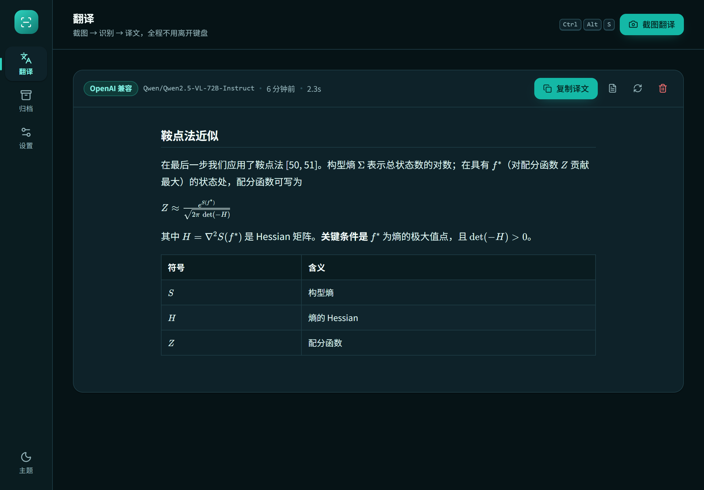
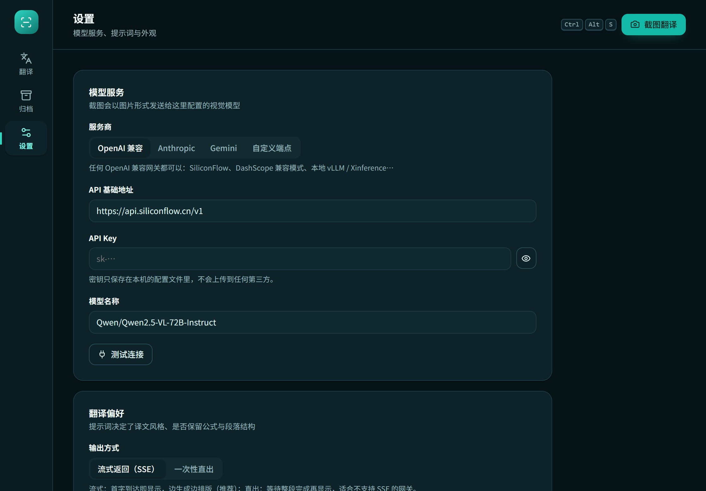

# 截译 · JieYi

截图即得译文的桌面工具：框选任意屏幕区域，交给视觉大模型翻译，公式/表格原样排版，结果自动归档并支持一键复制。

Rust + Tauri 2 外壳，React 19 + TypeScript 前端。是 `AI-Screenshot-Translator`（Qt6/C++）的 clean-room 重写。

```
Ctrl + Alt + S  →  框选  →  译文（KaTeX 公式 / 表格 / 代码）→  一键复制
```

[](https://github.com/Fakeboxs/jieyi/releases)
[](LICENSE)
[](#系统要求)
[](https://tauri.app)
[](https://react.dev)



## 下载

到 [Releases](https://github.com/Fakeboxs/jieyi/releases/latest) 下载：

| 文件 | 大小 | 适合 |
|---|---|---|
| `JieYi_0.1.0_x64-setup.exe` | 3.87 MB | 推荐。当前用户安装（无需管理员），中文向导，缺 WebView2 自动下载 |
| `JieYi-0.1.0-portable-win64.zip` | 4.59 MB | 便携版，解压即用 |

首次运行若被 SmartScreen 拦下：**更多信息 → 仍要运行**（安装包未做代码签名）。

## 现在能做什么

- **全局热键截图**：`Ctrl+Alt+S` 在任意应用内触发；鼠标所在显示器整屏冻结后框选，`Esc` 取消
- **多服务商**：OpenAI 兼容（含 SiliconFlow / DashScope 兼容模式 / 本地 vLLM、Xinference）、Anthropic `/v1/messages`、Gemini `generateContent`、自定义端点
- **输出方式可选**：**SSE 流式**（默认，首字即显示、边生成边排版、末尾打字光标）或**一次性直出**（等整段返回），在设置里一键切换
- **排版还原**：Markdown（marked + DOMPurify 白名单）+ KaTeX（`$…$`、`$$…$$`、`\(…\)`、`\[…\]`、`equation/align` 环境）+ 代码高亮样式 + 表格；流式时自动隐藏写了一半的公式尾巴
- **一键复制**：结果卡片主按钮复制 Markdown 译文，另可复制纯文本；成功后按钮变绿 + 底部 toast（剪贴板走 Tauri 插件，失败回退 `execCommand`）
- **归档**：SQLite 自动保存每次翻译（含截图 PNG）、按天分组、全文搜索、标签过滤、展开即复制/删除
- **设置**：服务商预设、API Key（可显隐）、模型、提示词、max_tokens / temperature、连接测试、明暗主题
- **托盘**：左键截图，右键菜单（截图翻译 / 显示主窗口 / 退出）
- **单窗口三标签**：翻译 / 归档 / 设置（`Ctrl+1/2/3`），只有一个 WebView2 宿主

## 界面

| 流式输出 | 归档 |
|---|---|
|  |  |

| 设置 | 安装向导 |
|---|---|
|  |  |

## 系统要求

- Windows 10 1809+ / Windows 11，x64
- Microsoft Edge WebView2 Runtime（安装包会自动补装；便携版需系统已有）
- 能访问你所配置的模型服务

## 跑起来

```bash
npm install
npm run tauri dev          # 开发（vite + 热更新）
npm run tauri build        # 出 NSIS 安装包（target/release/bundle/nsis）
```


前置：Rust stable、Node 20+、系统 WebView2（Win11 自带）。

### 本地联调（不花钱、不需要真 key）

```bash
python scripts/mock_server.py 8899       # 假 OpenAI 兼容服务，返回带公式的固定译文
```

把设置里的 API 基础地址改成 `http://127.0.0.1:8899/v1`，Key 随便填，模型填 `mock-vl`，然后 `Ctrl+Alt+S` 框一块屏幕即可跑通全链路。

## 结构

```
src/                      React 前端
  App.tsx                 三标签外壳、事件订阅、截图入口
  overlay.tsx             全屏框选层（拖动/尺寸提示/Esc）
  components/Reader.tsx   结果卡片 + 归档条目 + Markdown 渲染
  components/Archive.tsx  搜索、标签过滤、按天分组
  components/Settings.tsx 模型服务 / 翻译偏好 / 外观
  lib/bridge.ts           IPC 封装（含浏览器预览 mock）
  lib/markdown.ts         LaTeX 保护 → marked → 消毒 → KaTeX
  styles/app.css          设计令牌（浅/深）+ 组件样式
src-tauri/src/
  lib.rs                  托盘、全局热键、窗口编排、命令注册
  capture.rs              xcap 抓屏 + 逻辑像素裁剪 + PNG/Base64
  providers.rs            四种协议构造与响应解析
  store.rs                SQLite（与旧版 history.db 表结构兼容）
  config.rs               config.json（多字段，无多 profile）
design-system/jieyi/MASTER.md   ui-ux-pro-max 生成的设计系统（本项目的令牌来源）
scripts/                  图标生成 / mock 服务
```

数据目录：`%APPDATA%\app.jieyi.desktop\`（`config.json`、`jieyi.db`、`images\*.png`）。
旧版 `history.db` 可直接放进来：表结构一致，新增的 `provider / model / elapsed_ms` 列会自动 `ALTER TABLE` 补上。

## 已验证（真机跑过，不是"应该能跑"）

| 项 | 结果 |
|---|---|
| 全局热键注册 | `Ctrl+Alt+S` 在桌面任意位置触发，覆盖层出现 |
| 抓屏 + 框选 | 冻结桌面画面显示、拖动有尺寸提示、`Esc` 取消 |
| 裁剪 + 编码 | 选区按 `scale_factor` 换算物理像素裁剪，写入 `images\<uuid>.png` |
| 请求 | mock 服务日志：`POST /v1/chat/completions auth=Bearer sk-lo… images=1 bytes=25260` |
| 响应解析 + 落库 | `entries` 新增一行，主窗口自动切到结果页 |
| 渲染 | 标题/段落/行内公式/独立公式/表格/引用块全部正确，中文为系统黑体 |
| 一键复制 | 点击后按钮变"✓ 已复制"、toast 出现；剪贴板内容 = 367 字符的 Markdown 译文 |
| 错误路径 | 未填 Key 时框选 → toast「还没有填写 API Key（设置 → 模型服务）」，不崩 |
| release 构建 | `target/release/jieyi.exe` 8.53MB；NSIS 安装包 `JieYi_0.1.0_x64-setup.exe` 3.84MB |
| release 运行 | 单窗口正常显示译文（`elapsed` 显示 `5ms`），主题/字体正常 |
| SSE 流式 | mock 日志 `stream=True`；首字 0.3s 内出现，卡片带「生成中」+ 光标，逐步长出正文/公式/表格；完成后徽标消失、按钮恢复「复制译文」 |
| 直出模式 | mock 日志 `stream=False`；等待期显示骨架屏 + 禁用「复制译文」，整段到达后一次渲染 |
| 流式入库 | 流结束后整段落库（367 字符），耗时 1.1s = mock 的 31 个分片 × 35ms |

## 体积与内存（实测）

| | 旧版（Qt6/C++） | 新版（Tauri 2） |
|---|---|---|
| 安装体积 | 62MB 目录（Qt DLL 24MB + opengl32sw 20.6MB + D3Dcompiler 4.2MB + 插件 3.5MB） | **exe 8.53MB / 安装包 3.84MB** |
| 主进程 | 33.7MB WS / 6.8MB Private（未开窗） | 32.7MB WS / 5.6MB Private（主窗口已开） |
| WebView2 宿主 | 每个窗口一套（结果窗、归档窗各一） | 一套（单窗口三标签） |
| 依赖 | Qt6 运行时 + 5 个 Qt 插件目录 | 系统 WebView2，无额外运行时 |

> 内存的真相没变：占用大头仍是 WebView2/Chromium（本机整套 7 个进程，Private 合计 221.5MB）。
> 新版赢在"只有一套宿主"、磁盘 62MB → 8.5MB、以及去掉 Qt 依赖后冷启动更快。

## 与旧版的差异（取舍）

| 旧版 | 新版 |
|---|---|
| 只能等整段返回 | SSE 流式 / 直出 可选 |
| Qt Widgets 设置/归档 + WebView2 结果窗口（多宿主） | 单窗口三标签，单 WebView2 宿主 |
| 复制=按 `R` 切原始视图顺带复制 | 常驻复制按钮 + 纯文本复制 |
| 归档只读列表、删除靠 `dd` | 搜索、标签 chip、展开即复制/删除 |
| 62MB 目录（Qt + opengl32sw + D3Dcompiler） | 单个 exe + 系统 WebView2 |
| 高级 API 模板 `{{占位符}}` | 暂未移植（自定义端点按 OpenAI 兼容格式） |
| Umami 匿名统计默认开启 | 无任何遥测 |

## 还没做（下一步候选）

1. **停止生成**：目前流式中途无法取消（需要 AbortHandle + 前端按钮）
2. 多张截图合并翻译（旧版支持一次框多块）
3. 高级 API 模板（`{{model}}` 等占位符、自定义 headers）
4. 标签编辑 UI（数据结构已就绪）、导出 .md
5. 多显示器热键直达指定屏、上次选区记忆
6. 安装包签名 + 自动更新

## 分发

```bash
python scripts/gen_icons.py            # 应用图标（一次性）
python scripts/gen_installer_art.py    # 安装向导侧边栏/页眉（一次性）
python scripts/make_release.py         # 汇总 dist-release：安装包 + 便携包 + SHA256SUMS
```

`dist-release/` 产出：

| 文件 | 大小 | 说明 |
|---|---|---|
| `JieYi_0.1.0_x64-setup.exe` | 3.87 MB | NSIS 安装包，**当前用户安装**（`%LOCALAPPDATA%\截译`），中文向导，缺 WebView2 自动下载 |
| `JieYi-0.1.0-portable-win64.zip` | 4.59 MB | 便携版：`jieyi.exe` + 使用说明，解压即用 |
| `发布说明.md` / `SHA256SUMS.txt` | — | 面向用户的说明与校验和 |

安装/卸载实测：注册表 `HKCU\...\Uninstall\截译`（DisplayName 截译、Publisher JieYi、DisplayIcon 指向安装目录）、桌面与开始菜单快捷方式均正确创建；`uninstall.exe /S` 后程序目录、快捷方式、注册表项全部清除，`%APPDATA%\app.jieyi.desktop` 用户数据按设计保留。

**未做代码签名**，分发时提醒用户：SmartScreen 提示 → 更多信息 → 仍要运行。要彻底消除需要签名证书：

```powershell
signtool sign /fd SHA256 /tr http://timestamp.digicert.com /td SHA256 /a dist-release\JieYi_0.1.0_x64-setup.exe
```

> 改了 `productName`（当前为「截译」）会同时改变安装目录、快捷方式与「应用」里的显示名；`identifier` 保持不变，所以升级不会丢数据。

## 许可与来源

- 代码以 [MIT](LICENSE) 发布；第三方依赖与来源说明见 [NOTICE.md](NOTICE.md)。
- 本项目按 clean-room 思路重写：只借鉴「截图→视觉模型→Markdown」的产品思路与用户可见交互，未复制上游 C++ 代码、模板与图标资源，因此不受上游 GPL-3.0 传染。若后续要复用上游任何代码/资源，本仓库必须改为 GPL-3.0 并保留版权声明。
- 上游：`https://github.com/Diraw/AI-Screenshot-Translator`（GPL-3.0）——本仓库不包含其任何代码或资源。
